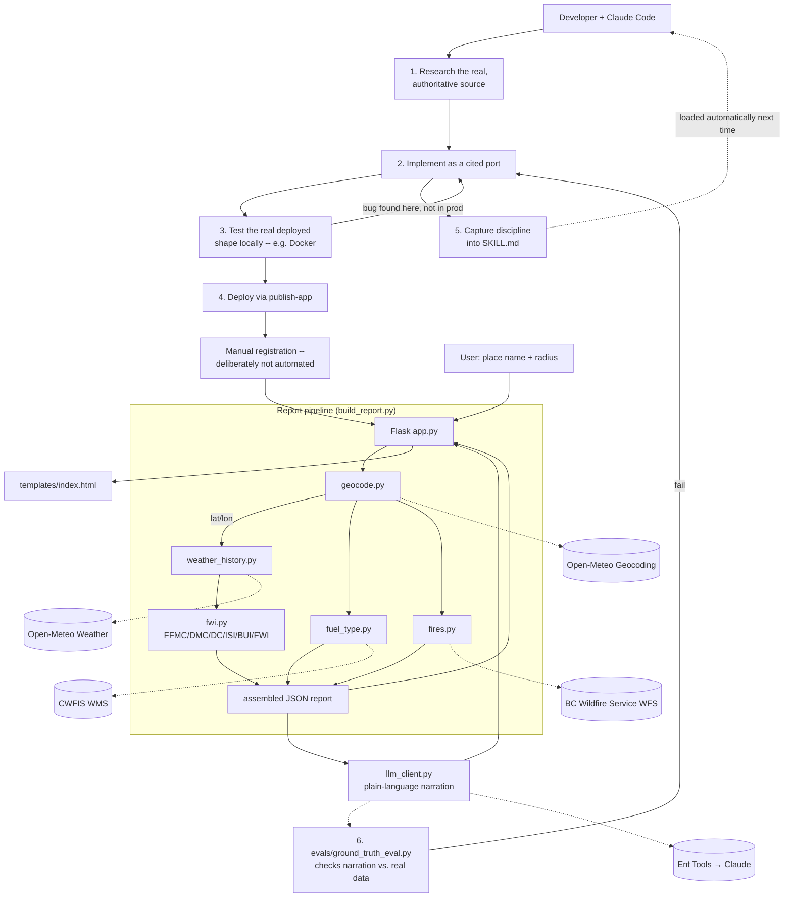

# BC Wildfire Predictor

A lightweight, queryable Fire Weather Index (FWI) report for any BC city, town, or lake — combining the official Canadian fire-danger formulas with live weather, real fire-service data, and a tightly-constrained AI narration layer.

This is also a worked example of a **harness**: a repeatable pattern for using Claude Code to build small, trustworthy, source-grounded data tools inside this NEXUS sandbox, without quietly inventing formulas, thresholds, or config, and without the discipline that catches that from being lost between sessions. Everything below describes both at once — the app is what the harness produced.

**Live app:** https://wildfire-poc-shabari.sandbox.aim.int.gov.ab.ca *(NEXUS SSO required)*

---

## The problem this harness addresses

Fire-danger information exists today, but not in a form a non-specialist can quickly use for one specific place — Canada's official Fire Weather Index maps (CWFIS) are province/national-scale raster maps, not a number for "the lake I'm driving to this weekend"; BC Wildfire Service publishes real fire locations as a GIS feed, not a plain-English answer to "is there a fire near where I'm going"; and the CFFDRS Fire Weather Index math is a real scientific standard locked inside an R package, not something most developers would go implement correctly from scratch.

Underneath that specific problem is a more general one this project is really about: an AI coding agent can build something like this fast, but speed without discipline is exactly how a tool ends up quietly hallucinating a threshold, reconstructing a formula from fuzzy memory instead of the real source, or shipping straight to production without ever testing the actual deployed container. None of that shows up as an error — it shows up as a wrong number nobody notices until it matters. The harness is the answer to "how do I get the speed without that risk, in a way that survives past one chat session."

## Who this is for

- **BC residents and travelers** who want a plain-language answer to "how dangerous is fire weather near X right now, and are there fires nearby."
- **GoA/BC public-sector staff** evaluating this as a template for similar "combine open data + official formulas + AI narration" tools in other domains (drought, flooding, air quality).
- **Developers using Claude Code in this sandbox** who want a concrete, inspectable example of "don't invent it, go find it" as a working discipline — every non-trivial number here traces back to a cited, verifiable source (see *How this was tested*).
- **Developers extending this to another province or territory** — see *Making this repeatable*, below.

## How the harness works — workflow and components

The workflow followed for every non-trivial piece of this app, and meant to be followed again for anything built on top of it:

1. **Research the real source first.** If something needs a formula, threshold, color, font, or config value that comes from an authority (a government dataset, a design system, a scientific standard), find and verify the live/authoritative source before writing anything — never reconstruct it from memory.
2. **Implement it as a cited port, not a guess.** Keep the reference material in the repo so a later change can diff against the same source, not against someone's recollection of it.
3. **Test the actual deployed shape before shipping.** Build and run the real Docker container locally, not just the Python code, before ever touching the cloud deploy target.
4. **Deploy through the sandbox's own tooling** (`publish-app`), and treat the one manual, non-automatable step (registration) as intentional.
5. **Write the discipline down where it survives.** Anything learned the hard way becomes an explicit rule in the skill file, not a note in a chat transcript that won't be there next session.
6. **Evaluate AI-generated output against ground truth, not vibes.** Anywhere the harness produces content via an LLM, check it against the real, deterministically-computed data it's narrating.

**Components:**

| Component | Role |
|---|---|
| Claude Code (Bash/Read/Write/Edit tools) | Executes the workflow — research, implement, test, deploy |
| This sandbox's `CLAUDE.md` conventions | The concrete deploy mechanics (`publish-app`, Docker/cert handling, `create-repo`) the workflow runs on top of |
| `.claude/skills/wildfire-likelihood/SKILL.md` | The versioned, committed discipline — non-negotiables, known gaps, extension and onboarding steps — that makes the workflow repeatable across sessions and people |
| `jurisdiction-prompt.md` | The non-technical input a person fills in to trigger onboarding a new province — see *Making this repeatable* |
| `geocode.py` | Place name → lat/lon (Open-Meteo, filtered to Canada) |
| `weather_history.py` | ~60 days of history plus a 7-day forecast (Open-Meteo) |
| `fwi.py` | The actual Fire Weather Index System math (FFMC/DMC/DC/ISI/BUI/FWI) + per-index/overall danger classification, national — not BC-specific |
| `fuel_type.py` | CFFDRS fuel type at a point (CWFIS, national) |
| `fires.py` | Nearby current/recent fires — **BC-specific**, queries BC Wildfire Service's WFS feed |
| `build_report.py` | Orchestrates the above into one report; also where the BC-only rejection check lives |
| `llm_client.py` | The one, tightly-scoped LLM call — plain-language narration only, never raw user text |
| `app.py` / `templates/index.html` | The Flask web app |
| `evals/ground_truth_eval.py` | Checks the AI narration against the real computed forecast, so the AI's prose can't silently drift from the math |
| `Wildfire_POC/docs/` | The human-readable build narrative and the reusable, non-wildfire-specific deploy runbook |

## Architecture



## Inputs / source material required

- **User input**: a BC place name (city, town, or lake) and a search radius in km.
- **Live external data** (no API keys needed): Open-Meteo (geocoding + weather), BC Wildfire Service (fire points via WFS), CWFIS/Natural Resources Canada (fuel-type WMS + official danger-class legends).
- **Reference material used to build this, not fetched at runtime**: the `cffdrs` R package source, the `bcgov/design-system` repo, the `@bcgov/bc-sans` npm package — cached under `bc_design_reference/` and `Wildfire_POC/extracted/wildfire-poc-input/cffdrs_r_reference/` for provenance.
- **Sandbox environment variables** (auto-provided by `publish-app`): `ENT_TOOLS_URL`, `ENT_TOOLS_API_KEY`.

## Outputs

- A JSON report (`Wildfire_POC/extracted/wildfire-poc-input/proposed_schema.json`): geocoded location, the weather series used, all six FWI indices with values and classes, a 7-day forecast, danger rating, fuel type, nearby fires, an AI-written advisory headline, and a mandatory, non-empty `limitations` array.
- The rendered page: a colored danger badge with plain-language caption and hover text, six FWI stat tiles (caption + high/low arrow + hover explanation), fuel type, nearby fires, the AI advisory banner, and the limitations list.
- A `SKILL.md` capturing the discipline learned, committed to the repo so it isn't session-bound.
- An eval suite (`evals/`) checking AI-generated content against ground truth.

## Setup and running it

```bash
# One-off report from the command line
cd wildfire-poc
python3 build_report.py "Kelowna" --radius-km 50

# Run the web app locally (needs ENT_TOOLS_URL / ENT_TOOLS_API_KEY in env)
python3 app.py

# Test the container before deploying -- this is step 3 above, and it matters:
# it's what caught the GCP/Docker MTU bug below before it ever reached Cloud Run
docker build -t wildfire-poc-local .
docker network create --opt com.docker.network.driver.mtu=1460 test-mtu-net
docker run -d --network test-mtu-net -p 8080:8080 \
  -e ENT_TOOLS_URL="$ENT_TOOLS_URL" -e ENT_TOOLS_API_KEY="$ENT_TOOLS_API_KEY" \
  wildfire-poc-local

# Run the ground-truth eval's self-tests (no network needed)
cd evals && python3 -m unittest test_ground_truth_eval -v

# Deploy to this NEXUS sandbox
publish-app wildfire-poc
# then register via the App Directory (apps.sandbox.aim.int.gov.ab.ca) -- manual, by design
```

## How this was tested and improved

- **Formula correctness**: `fwi.py` was validated against the `cffdrs` R package's own documented 1985 test dataset rather than trusting a from-memory reimplementation.
- **A real bug caught before deploy, not after**: testing the Docker image locally surfaced an MTU mismatch between this sandbox's GCP NIC (1460) and Docker's default bridge (1500) that silently hung every outbound HTTPS call from inside a container — invisible if the code had simply been deployed and "looked fine" in review.
- **Three real bugs found and fixed during development, each specifically because a verification step wasn't skipped**: the BC Wildfire Service's KML feed turned out to be a `NetworkLink` stub with no real coordinates; Open-Meteo's geocoder matched "Fort St John" to a mountain in Queensland, Australia before a country filter was added; and the country filter alone still let *any* Canadian province match (Calgary, Toronto), silently rendering "0 nearby fires" for a location BC's fire feed simply doesn't cover — now rejected explicitly with a clear error.
- **Iterative usability passes**: field labels, plain-language captions on every FWI tile, hover explanations, a danger-badge description, and high/low arrows sourced from CWFIS's own published per-index legends, not invented cutoffs.
- **AI-narration ground-truth eval** (`evals/ground_truth_eval.py`): flags the AI advisory if its text names a danger class that never occurred that week, or omits the real worst day. Fixture-tested (12 cases, no network call) before being run against a live model.
- **The skill file itself has been revised** based on this hindsight — each lesson above is now a non-negotiable rule in `SKILL.md`, not just a memory of a conversation.
- **Not yet done**: no automated `pytest` suite for `fwi.py`'s own math, no direct numeric cross-check against CWFIS's live station-based FWI feed, and the harness's other scoped AI evals (adversarial edge cases, a faithfulness judge, a payload-whitelist conformance check) aren't built.

## Making this repeatable — onboarding a new jurisdiction

The FWI math and weather data are already national, not BC-specific — `fwi.py` and `fuel_type.py` work anywhere in Canada unchanged. The two genuinely BC-specific pieces are `fires.py` (BC Wildfire Service's feed) and the `admin1` check in `build_report.py`. Making this repeatable for another province means replacing just those, following a real research process each time — not hardcoding a second province as a one-off.

**`jurisdiction-prompt.md`** is the input side of that: a short, non-technical template — province name, any wildfire data source you're already aware of, branding preferences, constraints, who to ask if the research gets stuck. It deliberately asks for no URLs, schemas, or GIS knowledge, since finding and verifying those live is the AI's job, not the form-filler's.

**`.claude/skills/wildfire-likelihood/SKILL.md`**'s "Onboarding a new jurisdiction" section is the process side: given a filled-in prompt, it walks through confirming the new province's exact geocoding `admin1` string, finding and *verifying* (not just trusting) its real fire-points feed the same way BC's was found and its broken KML caught, confirming the national FWI/fuel-type pieces need no changes, swapping branding from a real source if requested, respecting any stated constraints, and writing down what was found so the next session inherits it.

Handing a filled-in `jurisdiction-prompt.md` to a Claude Code session opened in this repo is the whole mechanism — the skill loads automatically and the steps above run as a checklist, not a from-scratch rediscovery.

## Value

- Converts several disparate, technical, GIS-literate-only data sources into a single plain-language answer usable in seconds.
- A concrete demonstration of "don't invent it, go find it" as a working discipline: every non-trivial number here (formulas, breakpoints, branding tokens) traces back to a cited, verifiable source.
- The skill-file and prompt.md mechanism means the discipline compounds — the next session, or the next developer, or the next province, doesn't have to rediscover the Fort St John bug or the MTU bug; they inherit the fix as a rule, and the onboarding steps as a checklist.

## Limitations, assumptions, and future opportunities

- **No Fire Behaviour Prediction** — only fire-*weather* danger (FWI), not spread rate or intensity; FBP needs slope and crown-closure data this POC doesn't have.
- **Fuel type is a single point lookup**, not an area average.
- **Daily weather aggregates approximate the FWI system's official noon-LST readings** — a documented, disclosed simplification.
- **Cold-start weather history**: ~60 days is a compromise for a stable Drought Code, not a guarantee of full-season accuracy.
- **The repeatability mechanism is untested on a second jurisdiction** — `jurisdiction-prompt.md` and the skill's onboarding steps are designed to generalize, but that's a design claim, not yet a demonstrated track record.
- **No automated test suite** for `fwi.py`'s own math or a Flask endpoint smoke test.
- **Logging**: the app runs on Flask's built-in development server, which logs full request URLs (including the raw place-name query) to stderr, captured by Cloud Run's default logging — identified as worth fixing, not yet remediated.
- **PII**: no raw free-text currently reaches the LLM call (`llm_client.py`'s payload is a hand-picked whitelist) — true today because there's no free-text field besides place-name search; would need active enforcement if a future feature adds one.
- **Map-drawing / farm-boundary marking** was requested and scoped (Leaflet + Leaflet.draw) but intentionally not built this round.
- **No automated enforcement of the harness's own discipline** — nothing currently stops a future session from skipping a step; it relies on the skill file being read and followed, not a pre-commit hook checking "did you cite a source for this."

---

*Built iteratively with Claude Code in the NEXUS sandbox — see `Wildfire_POC/docs/conversation-summary.md` for the full build narrative and `Wildfire_POC/docs/harness-build-steps.md` for the reusable deploy runbook.*
